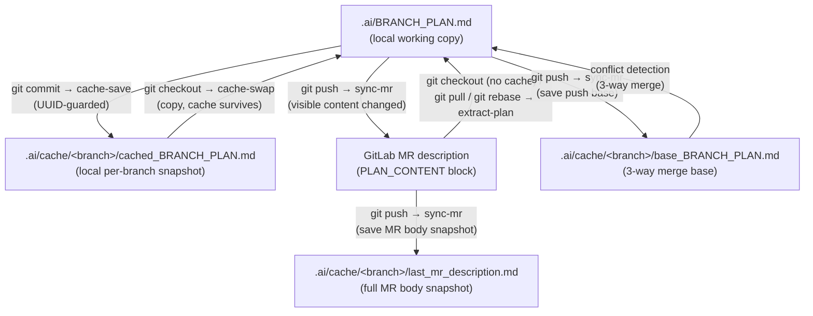
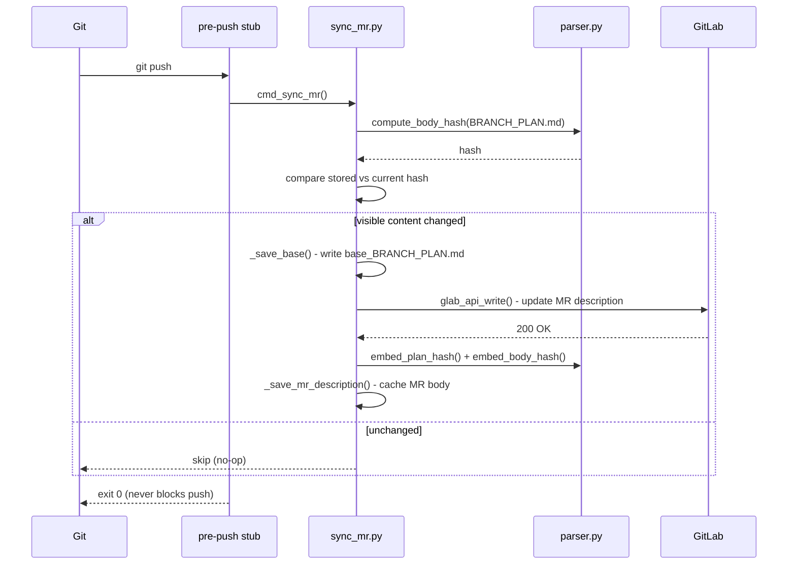

# Plan management

## What you get

Drop into any project and:

- **Claude knows your workflow rules immediately** - the orchestrator
  skill auto-loads at session start, enforcing role workflows (fixer /
  featurer / refactorer / tester / coder / gitter / plan-writer) for any
  change.
- **`git push` updates your MR description** from your local `BRANCH_PLAN.md` -
  no manual sync, no merge tooling, no copying.
- **`git checkout other-branch`** swaps in that branch's `BRANCH_PLAN.md` from
  a local cache - no merge conflicts on your working tree.
- **Joining a branch with an existing MR** auto-pulls its `BRANCH_PLAN.md`
  from the MR description into your local cache - no manual fetch.
- **`mr` CLI** for on-demand control: `mr new --branch-name <b>`
  creates the branch + opens a draft MR + pulls existing plan;
  `mr plangen` regenerates the plan via AI pipeline; `mr sync` /
  `mr planget` / `mr status` for explicit operations; `mr verify`
  runs lint + tests.

You did NOT copy any of this into the project. You did NOT install
per-project Python deps. You did NOT pin versions. The tooling lives
once on your machine and shows up everywhere.

## Why this design

Putting AI tooling INTO each project means forking the same hooks
across N repos, version drift, per-project setup cost, and the risk
of accidentally committing private workflow files. We sidestep all of
it - one source of truth, one Python install, one managed block in
`~/.bashrc`. Consumer projects stay clean: the only artifacts are
`.git-hooks/` (symlinked stubs) and `.ai/` (runtime-only, untracked).

## Architecture

### Components

| Module | File | Owns |
|---|---|---|
| `cache` | `git_hooks_impl/plan/cache.py` | Per-branch BRANCH_PLAN.md snapshot save/restore/prune; UUID guard against cross-branch corruption |
| `parser` | `git_hooks_impl/plan/parser.py` | BRANCH_PLAN.md structural parsing: meta block, hashing, visible/hidden section split, body-hash |
| `sync_mr` | `git_hooks_impl/entry_points/sync_mr.py` | Push local BRANCH_PLAN.md → GitLab MR description; body-hash change detection; 3-way conflict detection |
| `extract_plan` | `git_hooks_impl/entry_points/extract_plan.py` | Pull MR description → local BRANCH_PLAN.md; cache-swap on checkout; cache-save on commit; cache-prune on branch delete |
| `generator` | `git_hooks_impl/plan/generator.py` | 4-step AI pipeline for `mr plangen`: fill MR body → enhance with plan sections → enrich with evidence → validate + polish |

### Hook → command map

6 of the 8 linked stubs run AI tooling's own plan-sync commands:

| Git hook | Trigger | Command | Entry point |
|---|---|---|---|
| `pre-push` | `git push` | `sync-mr` | `sync_mr.py` |
| `post-checkout` | `git checkout` | `cache-swap` | `extract_plan.py:cmd_cache_swap` |
| `post-commit` | `git commit` | `cache-save` | `cache.py:_save_cache` |
| `post-merge` | `git pull` / merge | `extract-plan` | `extract_plan.py:cmd_extract_plan` |
| `post-rewrite` | `git rebase` (not amend) | `extract-plan` | same |
| `reference-transaction` | branch delete (committed state only) | `cache-prune` | `cache.py:_prune_stale_caches` |

The other 2 linked stubs are unrelated to plan-sync. They forward to the
external `pre-commit` framework instead of running an AI tooling command:

| Git hook | Trigger | Forwards to |
|---|---|---|
| `pre-commit` | `git commit` (before message entry) | `pre-commit` framework's `hook-impl` runner |
| `commit-msg` | `git commit` (message validation) | `pre-commit` framework's `hook-impl` runner |

### File paths

| Path | Role |
|---|---|
| `git-hooks/` | 8 shell stubs - symlinked into `<project>/.git-hooks/` via `mr setup` |
| `git_hooks_impl/` | Python hook implementation package |
| `mr` | CLI entry point (bash script) |
| `setup/` | `mr setup` scripts (link, env, tools) |
| `claude/skills/orchestrator/SKILL.md` | Orchestrator skill entry point (rule index) |
| `claude/skills/orchestrator/shared/common_resources.md` | Catalog of shared scripts + common agents (source of truth for inventory) |
| `claude/agents/` | Agent definition files: persistent sub-agents, per-role one-shot sub-agents, and common one-shot sub-agents (see `common_resources.md` for the catalog) |

<details>
<summary>Data flow diagram (click to expand)</summary>



</details>

<details>
<summary>Hook execution sequences (click to expand)</summary>



```mermaid
sequenceDiagram
    participant Git
    participant Hook as post-checkout stub
    participant CacheSwap as extract_plan.py:cmd_cache_swap
    participant Cache as cache.py

    Git->>Hook: git checkout &lt;branch&gt;
    Hook->>CacheSwap: cmd_cache_swap(prev_ref)
    CacheSwap->>Cache: _save_cache(prev_branch) - snapshot departing branch
    Cache->>Cache: UUID guard check
    Cache-->>CacheSwap: saved (or UUID mismatch - skip)
    CacheSwap->>Cache: _restore_cache(new_branch)
    alt cache hit
        Cache-->>CacheSwap: copy cached_BRANCH_PLAN.md → .ai/BRANCH_PLAN.md
    else cache miss
        CacheSwap->>CacheSwap: fall through to extract-plan (fetch from MR)
    end
    Hook-->>Git: exit 0 (never blocks checkout)
```

</details>

## Install

### 1. Install ai_tooling (once per machine)

```bash
cd /path/to/ai_tooling
./mr setup
```

Installs `glab` / `jira` / `claude` CLIs, writes the `~/.bashrc`
managed block, symlinks the orchestrator skill + agents + hooks
into `~/.claude/`, prints a `settings.json` merge instruction.

### 2. Merge ~/.claude/settings.json

`mr setup` prints a merge instruction at the end of step 1. Apply it now:

1. Back up first (recommended):
   ```bash
   cp ~/.claude/settings.json ~/.claude/settings.json.bak
   ```

2. For every key in `$AI_TOOLING_SRC/claude/settings.json` (template):
   - Key present with same value → no change
   - Key present with different value → ai_tooling-managed keys win; your other keys stay
   - Key absent in your file → add it

ai_tooling-managed keys (must match the template):
- `hooks.PreToolUse` (matchers `Agent|Task` and `Bash|PowerShell`) - `gate.py`, states the current orchestrator mode on a role dispatch or a git commit/push
- `hooks.SessionStart` (matcher `startup|resume|clear`) - `session_start.py` (loads orchestrator skill + branch/plan status at session start) and `clear_persistent_agent_registry.py` (resets the per-branch persistent-agent duplicate-spawn registry)
- `hooks.PreCompact` - `precompact.py`, records the current workflow step before compaction
- `hooks.SessionStart` (matcher `compact`) - `resume_after_compact.py`, injects a resume block naming that step afterward
- `hooks.PostToolUse`: `check_em_dash.py`, replaces em dash usage with `-` in `.cpp`/`.hpp`/`.py`/`.md` files after every Edit/Write; `check_line_citations.py`, flags `file:line` citations in `.cpp`/`.hpp`/`.h`/`.py`/`.md`/`.txt` files after every Edit/Write
- `hooks.PreToolUse` (matcher `Agent`) - `check_persistent_agent_dup.py`, blocks a second dispatch of the same persistent role against the same repo
- `permissions.allow` - entries marked `_ai_tooling: true`
- `statusLine` - only if you don't already have one

### 3. Activate (current shell)

`mr setup` prints this reminder at the end. To activate manually:

```bash
source ~/.bashrc
```

Or just open a new terminal. Verify with `mr help`.

### 4. Wire each consumer project (once per project)

```bash
cd /path/to/your-project
mr setup
```

Symlinks the 8 hook stubs into `.git-hooks/` and sets
`core.hooksPath = .git-hooks`. From now on, hooks fire automatically.

### 5. Update ai_tooling (when new commits land)

```bash
cd $AI_TOOLING_SRC
git pull
./mr setup
```

Re-runs the full install: re-links `~/.claude/skills/`, `~/.claude/agents/`, and
`~/.claude/hooks/` from the updated source, and reprints the settings merge
instruction if the template has new keys. Per-tree "up to date" lines print for
trees with no changes.

## Commands

| Command | Purpose |
|---|---|
| `mr sync` | Force-push local `BRANCH_PLAN.md` to the MR description |
| `mr planget` | Pull plan from MR description into local `BRANCH_PLAN.md` |
| `mr plangen [--force]` | Generate `BRANCH_PLAN.md` via the 4-step AI pipeline (uses cache; `--force` regenerates) |
| `mr status` | Show whether local plan is ahead, behind, or in sync |
| `mr new --branch-name <b>` | Create branch + push + open draft MR + pull plan if any |
| `mr verify` | Run lint (ruff) + unit-test suite; exit nonzero if either fails |
| `mr setup` / `mr setup -y` | Full machine install when run from `$AI_TOOLING_SRC`; per-project hook wiring when run from a consumer project. Context-detected. Re-links hook stubs and refreshes `~/.claude/` skills/agents/hooks in one step. `-y` / `--yes` skips the confirmation prompt. |
| `mr on` | Enable tooling - takes effect immediately in the current shell + persists for new shells via the `~/.bashrc` managed block |
| `mr off` | Disable tooling - takes effect immediately in the current shell + persists for new shells via the `~/.bashrc` managed block |
| `mr help` | Print usage |

## Tooling disabling

Two paths:

**Persistent** (survives shell restart):

```bash
mr off    # flips AI_TOOLING_ENABLED=false in ~/.bashrc managed block
mr on     # flips back to true
```

Both take effect immediately in the current shell (the `mr()` shell function exports
the env var before delegating to the script) and persist for new shells via the
`~/.bashrc` managed block. Idempotent - if already in the target state, prints
`Tooling already <state>.` If the managed block is missing, exits non-zero: run
`mr setup` first.

**Emergency** (current shell only, no file edit):

```bash
export AI_TOOLING_ENABLED=false
```

## Where files live

| Path | Role |
|---|---|
| `$AI_TOOLING_SRC` | Source of truth (this repo) |
| `~/.claude/` | Orchestrator skill + agents + hooks (symlinked) |
| `<project>/.git-hooks/` | Shell hook stubs (symlinked, untracked) |
| `<project>/.ai/` | Per-project plan + cache + artifacts (untracked, runtime-only) |
