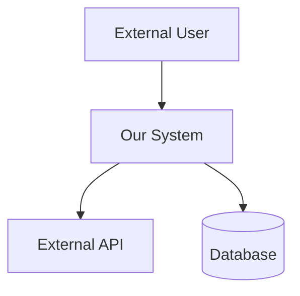

# C4 Model — Diagram Reference for LLM

## Overview

The C4 model (Context, Containers, Components, Code) is a hierarchical
approach to software architecture diagramming by Simon Brown.

## Four Levels

### Level 1: Context Diagram
- Shows the system as a box surrounded by users and external systems
- Answers: who uses the system? What other systems does it interact with?

### Level 2: Container Diagram
- Zooms into the system box from Level 1
- Shows applications, databases, file systems, message queues
- Answers: what are the high-level technology choices?

### Level 3: Component Diagram
- Zooms into one container
- Shows internal components and their relationships
- Answers: what are the major structural building blocks?

### Level 4: Code Diagram (optional)
- Zooms into one component
- UML class diagrams or similar
- Usually auto-generated, not manually drawn

## ASCII Format

```
+------------------+
|   External User  |
+--------+---------+
         |
         v
+--------+---------+     +------------------+
|   Our System     |---->|  External API    |
|  [Container]     |     +------------------+
+--------+---------+
         |
    +----+----+
    |         |
    v         v
+---+---+ +---+---+
|Module A| |Module B|
+-------+ +--------+
```

## Mermaid Format (for complex diagrams)



## References

- https://c4model.com/
- Simon Brown, "The C4 Model for Software Architecture"
