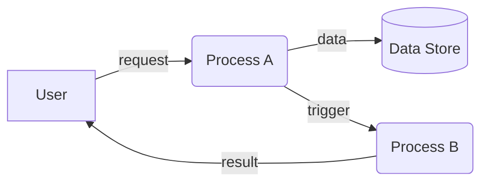

# Data Flow Diagrams — Reference for LLM

## Overview

Data Flow Diagrams (DFD) show how data moves through a system.
Useful for understanding input/output transformations and data storage.

## Elements

| Symbol | Name | Purpose |
|--------|------|---------|
| Rectangle | External Entity | Source or destination of data |
| Rounded rectangle / Circle | Process | Transforms data |
| Open rectangle | Data Store | Where data is persisted |
| Arrow | Data Flow | Direction of data movement |

## Levels

### Level 0: Context Diagram
- Single process (the whole system)
- External entities and data flows in/out

### Level 1: Detailed
- Break the single process into sub-processes
- Show data stores
- Show data flows between sub-processes

### Level 2+: More Detail
- Break sub-processes further
- Show internal logic

## ASCII Format

```
[User] --request--> (Process A) --data--> [Data Store]
                        |
                        v
                    (Process B) --result--> [User]
```

## Mermaid Format



## Key Rules

- Every process must have at least one input and one output
- Data flows must be named (what data, not how)
- Data stores are passive (processes read/write to them)
- External entities are outside system boundary

## References

- Tom DeMarco, "Structured Analysis and System Specification"
- https://en.wikipedia.org/wiki/Data-flow_diagram
